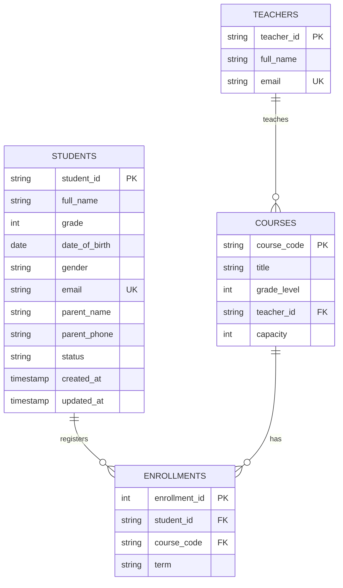

# ABS Student Enrollment Mini Portal (Flask + MySQL Relational Database)

A modern, responsive, full-featured Python Flask web application integrated with **MySQL** using **Pure Raw SQL (PyMySQL DB-API 2.0)**. 

The system implements a complete **K-12 School Management & Course Enrollment System** across 4 relational tables.

---

## 🗄️ Relational Database Architecture



---

## 🌟 Key Features

1. **Student Management (CRUD)**:
   - **Enroll Student**: Register students with matriculation ID, full name, K-12 grade level (1–12), parent contact details, and initial status (`Active` / `Withdrawn`).
   - **Student Directory**: Interactive dashboard with multi-field search (ID, name, email, parent), grade-level filtering (1–12), status filtering, and sorting.
   - **Student Profile Dossier**: Detailed personal and guardian info, along with their active course registrations.
   - **Edit & Delete**: Full record modification and modal-protected deletion (cascades to enrollments).

2. **Courses & Relational Course Enrollments**:
   - **Curriculum Directory** (`/courses`): View all subjects, grade levels, assigned instructors, and real-time student enrollment load progress bars.
   - **Course Enrollment & Drop**: Directly enroll students into courses or remove enrollments right from their student dossier page.

3. **Statistics Dashboard**:
   - Live aggregated counters for *Total Students*, *Active Students*, *Withdrawn Students*, and *Courses Available*.

4. **Data Export & RESTful APIs**:
   - `GET /export/csv`: Instant export of all student and guardian records to CSV.
   - `GET /api/students`: JSON endpoint of all students.
   - `GET /api/students/<student_id>`: Single student details in JSON.
   - `GET /api/courses`: JSON catalog of courses.
   - `GET /db-status`: Live MySQL connection diagnostic.

---

## 📁 Project Structure

```
ABS_Student_Enrollment_MiniPortal/
├── app.py                  # Main Flask application using Pure Raw SQL
├── db.py                   # PyMySQL database connection manager (g context)
├── config.py               # Database configuration and .env loading
├── models.py               # SQLAlchemy models (Students, Teachers, Courses, Enrollments)
├── schema.sql              # MySQL DDL for all 4 tables with constraints & seed data
├── requirements.txt        # Python package dependencies
├── .env / .env.example     # Environment variables (MySQL host, user, password, db)
├── templates/
│   ├── base.html           # Base layout with navbar, alerts, modals & footer
│   ├── index.html          # Dashboard & student data table with search/filters
│   ├── add_student.html    # Enrollment registration form
│   ├── edit_student.html   # Student edit form
│   ├── student_detail.html # Full student dossier profile card with course enrollment
│   └── courses.html        # Courses directory with instructors & capacities
├── test_app.py             # Automated unit tests (9/9 Passing)
└── README.md               # Documentation and setup instructions
```

---

## 🚀 Quick Start Guide

### 1. Activate Environment
```powershell
.\venv\Scripts\Activate.ps1
```

### 2. Configure MySQL in `.env`
Ensure MySQL is started (e.g. via XAMPP or local MySQL Service):
```env
DB_TYPE=mysql
MYSQL_HOST=localhost
MYSQL_PORT=3306
MYSQL_USER=root
MYSQL_PASSWORD=
MYSQL_DB=student_portal
```

### 3. Run the Application
```powershell
python app.py
```
Open **`http://localhost:5000`** in your browser.

---

## 🧪 Running Automated Tests
```powershell
python test_app.py
```
All 9 unit tests verify routes, enrollment, editing, course allocation, CSV export, and deletion.
